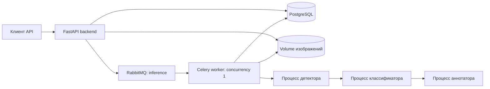

# План проекта: API обработки изображений

Актуальная архитектура от 11.10.2026. Реализованы API, PostgreSQL/Alembic,
файловое хранение, publisher и `process_image` с отдельными модельными процессами.
Пользователь утвердил RF-DETR Small, ViT-B/16 и Florence-2 base-ft.
Слои API/service/repository и внедрение сессии БД добавлены по его явной задаче.
Интеграция проверяется с настоящими БД/брокером/worker и mock-моделями;
реальный smoke тройки ещё не выполнен. Команды и границы проверки — в README.

## 1. Объём ближайшей реализации

Пользователь загружает изображение через API. Приложение сохраняет файл,
последовательно запускает **один детектор, один классификатор и один аннотатор**,
сохраняет результаты каждого этапа в PostgreSQL и позволяет прочитать их как JSON.
Данные должны переживать перезапуск контейнеров и позволять позднее построить
изображение с рамками без повторного инференса.

Сейчас не нужны UI, выдача изображений, генерация overlay, поиск в интернете,
редактирование аннотаций и согласование ответов моделей. Это возможные следующие
задачи; заранее создавать для них модули, таблицы и endpoints не нужно.
Поиск остаётся частью исходного задания курсовой, но исключён из текущего этапа.

Научная часть уже завершена: три независимых сравнения по четыре готовые модели.
Их результаты, скрипты, конфиги и отчёты сохраняются. В приложение войдут только
три выбранных checkpoint — по одному на этап. Утверждены RF-DETR Small, ViT-B/16 и Florence-2 base-ft;
выбор основан на сохранённых сравнениях. Совместимость реального инференса
ещё нужно подтвердить отдельным smoke. Не считать все 12 моделей обязательными участниками приложения.
Обучение, fine-tuning и LoRA не предусмотрены.

## 2. Четыре контейнера



| Сервис Compose | Ответственность |
|---|---|
| `backend` | FastAPI: загрузка, проверка и сохранение файлов, создание задания, отправка в RabbitMQ, чтение JSON из БД. Без GPU и загрузки весов. |
| `db` | PostgreSQL: метаданные изображений, статусы заданий и все результаты моделей. Постоянный volume. |
| `rabbitmq` | Брокер Celery, одна durable-очередь `inference`, persistent-сообщения. Постоянный volume. |
| `worker` | Один Celery worker: одна задача `process_image(job_id)` выполняет три этапа и записывает результаты в PostgreSQL. Только этому сервису нужен GPU. |

Backend и worker используют общий Python-код, SQLAlchemy и Alembic. В RabbitMQ
передаётся только `job_id`; файлы, тензоры, base64 и captions туда не отправляются.
Celery result backend не нужен: API читает предметные результаты из PostgreSQL,
а не из `AsyncResult`. Redis, Celery Beat, Flower и отдельные сервисы моделей
в первую версию не входят.

Одна Celery-задача обрабатывает одно изображение целиком. Не создавать chain/group
из трёх задач: на одном GPU последовательность и частичные результаты проще
контролировать внутри `process_image`. Worker-координатор сам не загружает веса;
каждый этап запускается отдельным свежим Python-процессом через exec/subprocess.
Завершение процесса освобождает память до следующей модели. Классификатор
загружается один раз для всех вырезок, batch size 1.

## 3. Загрузка, публикация и обработка

1. `POST /images` принимает multipart-файл: JPEG/PNG, до 10 MiB и 25 мегапикселей,
   одно статичное изображение. Проверяются фактическое декодирование и размеры;
   лимиты настраиваются. Некорректная загрузка не создаёт задание.
2. Backend сохраняет исходные байты и нормализованную RGB PNG-копию с применённым
   EXIF orientation. Имена файлов строятся из UUID, пользовательское имя — метаданные.
3. В одной транзакции создаются `images`, задание `queued` с
   `publish_status=pending` и три строки `model_results` со статусом `pending`.
   Выбранные модели и параметры фиксируются до отправки сообщения.
4. После commit API отвечает `202 Accepted` с `image_id`, `job_id`, `status_url`.
   Ответ означает сохранение задания, а не начало инференса или подтверждение брокера.
5. Один небольшой цикл публикации в lifespan FastAPI отправляет сохранённые
   `pending`-задания в RabbitMQ, используя publisher confirms. После подтверждения
   обновляются только `publish_status=sent` и `published_at`; статус обработки
   не переписывается — worker мог уже начать задачу.
6. Celery получает `process_image(job_id)`, проверяет запись БД, получает общий
   inference-lock и повторно читает статус. Только затем начинает обработку.
7. Детектор сохраняет рамки, исходные классы и scores. После завершения его процесса
   классификатор обрабатывает все crops и сохраняет top-k по `object_id`.
8. После завершения классификатора отдельный аннотатор получает нормализованное
   изображение без рамок и ответов других моделей; его `raw_caption` неизменяем.
9. Worker сохраняет итоговый статус транзакцией в PostgreSQL, затем подтверждает
   сообщение. `GET /jobs/{job_id}` читает частичные или завершённые результаты из БД.

### Разрыв между PostgreSQL и RabbitMQ

Commit БД и публикация сообщения не являются одной транзакцией. Поля публикации
в `jobs` выполняют роль минимального outbox: отдельная таблица/сервис не нужны.
Цикл раз в несколько секунд выбирает `queued/pending`, отправляет сообщения с
ограниченным сетевым timeout и повторяет неудачные публикации с backoff, например
5–60 секунд. Ошибка и время следующей попытки видны в БД. Вызовы брокера выполняются
вне HTTP event loop; открытая транзакция БД не ждёт сетевого подтверждения.

После перезапуска API цикл продолжает отправку. Если RabbitMQ недоступен,
загрузка всё равно сохраняется и возвращает `202` с `publish_status=pending`.
Если недоступна БД, загрузка завершается ошибкой, успешный приём не объявляется.
Если брокер принял сообщение, а отметка `sent` не сохранилась, возможна повторная
публикация. Это ожидаемо: обработка обязана выдерживать дубликаты. `task_id=job_id`
удобен для логов, но сам по себе не предотвращает повторное выполнение.

В первой версии один экземпляр API с одним Uvicorn worker, один издатель и один
Celery worker. При аварии API публикация ждёт его возвращения; уже отправленные
задачи Celery продолжает выполнять. Повторный пользовательский POST создаёт новое
изображение и задание; SHA-256 не используется для автоматической дедупликации.

## 4. Хранение: три таблицы

Связи: `images 1 → N jobs`, `jobs 1 → 3 model_results`.
Идентификаторы — UUID, даты — `timestamptz` в UTC, результаты — JSONB.

| Таблица | Поля и назначение |
|---|---|
| `images` | `id`, `original_filename`, `original_path`, `original_sha256`, `original_mime`, `original_size_bytes`, `normalized_path`, `normalized_sha256`, `width`, `height`, `normalization_version`, `created_at`. Размеры относятся к нормализованному изображению. |
| `jobs` | `id`, `image_id` (FK), `status`, `current_stage`, `created_at`, `started_at`, `finished_at`, `error`. Также `publish_status` (pending/sent), `published_at`, `publish_attempts`, `next_publish_at`, `publish_error`, `processing_attempts`. История обработки и состояние публикации; доставкой занимается RabbitMQ. |
| `model_results` | `id`, `job_id` (FK), `stage`, `status`, `model_name`, `model_revision`, `weights_sha256`, `parameters` (JSONB), `schema_version`, `payload` (JSONB), `started_at`, `finished_at`, `duration_ms`, `error`. Одна строка для каждого из трёх этапов. |

Ограничения БД: внешние ключи, допустимые статусы/этапы и уникальность `(job_id, stage)`.
Начальные индексы: `jobs(publish_status, next_publish_at)` для публикации, `jobs(image_id)`; уникальный индекс
результата покрывает чтение по заданию. GIN-индексы по JSONB добавляются только под
реальные запросы. Реестры моделей, таблицы артефактов и ревизий текста пока не нужны.
Версия checkpoint, SHA-256 весов и параметры хранятся прямо в строке этапа.

**Все результаты моделей находятся в PostgreSQL.** Изображения хранятся файлами
в общем постоянном volume backend/worker; БД содержит пути и метаданные. Не записывать base64
в JSONB. Для восстановления приложения нужны и backup PostgreSQL, и volume файлов;
копии одной БД недостаточно. Данные нельзя оставлять только в слое контейнера.

Файлы сначала записываются во временный каталог, затем атомарно переименовываются
в окончательный каталог изображения; только после этого фиксируется транзакция БД.
При отказе БД API возвращает ошибку и удаляет только файлы текущей неуспешной загрузки.
Сбой между файловой записью и commit может оставить каталог без записи БД: для MVP
достаточна ручная проверка таких каталогов, автоматический сервис очистки не нужен.
После commit исходный и нормализованный файлы неизменяемы.

## 5. Форматы результатов

Внутренние тензоры библиотек в JSON не попадают. Результаты проверяются Pydantic
перед записью, числа должны быть конечными. Все модели относятся к одному `image_id`
через задание; `object_id` связывает классификацию с детекцией внутри задания.

| Этап | Содержимое `payload` |
|---|---|
| `detection` | `coordinate_space: normalized_image`, `bbox_format: xyxy`, `image_width`, `image_height`, `objects`: для каждого `object_id`, `bbox`, `label`, `class_id`, `label_space`, `score`. |
| `classification` | `objects`: для каждого `object_id`, фактический целочисленный `crop_bbox`, `status`, `top_k` (synset/class_id, label, score), при ошибке — `error`. |
| `annotation` | `raw_caption`. Prompt, decoding parameters и seed, если применим, находятся в `parameters`. |

`bbox = [x1, y1, x2, y2]` — пиксельные координаты на сохранённой нормализованной
копии, с правой/нижней границей как исключающей: `0 ≤ x1 < x2 ≤ width`,
`0 ≤ y1 < y2 ≤ height`. Преобразования resize/letterbox детектора обращаются
до сохранения. Для crop используются floor левых/верхних, ceil правых/нижних
координат и ограничение границами изображения; сохраняется фактический `crop_bbox`.

Сохранять исходную метку детектора и метки классификатора раздельно: COCO class_id
и ImageNet synset не взаимозаменяемы. Высокий softmax классификатора не доказывает,
что неизвестный объект входит в его словарь. Автоматически заменять подпись рамки
результатом классификации или усреднять scores разных моделей не нужно.

Для будущей картинки с рамками достаточно `normalized_path`, размеров и детекций:
API сможет прочитать файл и нарисовать bbox с label/score. Повторный инференс
и заранее сохранённый overlay не потребуются. Выдача файлов и renderer сейчас
не входят в реализацию.

## 6. Celery, повторы и ошибки

Первый worker: `--pool=prefork --concurrency=1 --prefetch-multiplier=1 -Q inference`.
В родителе Celery и при импорте tasks не инициализировать CUDA. Все ML-библиотеки
и веса загружаются только в свежих процессах этапов, а не в fork-пуле Celery.

Настройки: `task_acks_late=True`, `task_reject_on_worker_lost=True`,
`task_ignore_result=True`, JSON serializer/accept_content, persistent delivery;
для pyamqp — `broker_transport_options={"confirm_publish": True}`.
Очередь и exchange объявляются явно как durable, маршрутизация задачи фиксирована.
Один узел RabbitMQ сохраняет данные при обычном перезапуске с volume, но не даёт HA.

Общий со сравнениями `storage/locks/inference.lock` держится на всём выполнении
задания и наследуется модельными потомками. Дубликат повторно проверяет БД **после**
получения lock. До освобождения lock должны завершиться все модельные процессы.
Даже при потере брокера и повторной доставке две модели одновременно не запускаются.
Смена статуса БД сама по себе не подтверждает освобождение GPU.

### Повторная доставка

- Для конечного `succeeded/partial/failed` задача ничего не пересчитывает и выходит.
- При аварии worker незавершённое сообщение возвращается в очередь. После получения
  lock проверяются сохранённые этапы. Этапы с конечными статусами не перезаписываются;
  продолжаются только `pending` и прерванный `running`. Готовые детекции дают те же
  `object_id` для классификатора.
- `processing_attempts` увеличивается в БД перед выполнением незавершённых этапов.
  Для первого варианта максимум две попытки обработки задания: исходная и одна
  попытка восстановления. При следующей доставке незавершённые этапы закрываются
  ошибкой `attempts_exhausted`, задание становится `partial/failed`, сообщение ACK.
  Проверку счётчика и повторное чтение статуса выполнять под inference-lock.
- Если все этапы уже сохранены, но итог jobs/ACK не успел записаться, итоговый статус
  восстанавливается из результатов без нового инференса и расходования попытки.
- Уникальность `(job_id, stage)` предотвращает дубли строк. Payload этапа и его
  конечный статус записываются одной короткой транзакцией. На сбое между расчётом
  и commit незаписанный этап может выполниться повторно: exactly-once не обещается.

### Обычные ошибки

Статусы задания: `queued → running → succeeded | partial | failed`.
Статусы этапа: `pending → running → succeeded | partial | failed | skipped`;
зависимый этап может перейти из `pending` сразу в `skipped`.

- Ноль рамок — успешная детекция, классификация `skipped/no_detections`, аннотатор
  выполняется. При его успехе задание `succeeded`.
- Сбой детектора — классификация `skipped/detection_failed`; аннотатор выполняется
  после остановки процесса детектора. Сбой аннотатора не удаляет другие результаты.
- Ошибки отдельных crops хранятся по объектам. Часть вырезок обработана — этап
  `partial`, ни одна не обработана — `failed`.
- `partial` означает успешные результаты вместе со сбоем; `failed` — отсутствие
  успешных результатов. `succeeded` требует успеха всех обязательных этапов,
  кроме штатного пропуска классификации при нуле рамок.
- Ошибки модели, неверные входные данные и пойманный CUDA OOM фиксируются в БД;
  бесконечного `autoretry_for=(Exception,)` нет. Неожиданное исключение приложения
  также должно завершить процессы и сохранить `internal_error`, если БД доступна.
  Повторная доставка после аварии
  отличается от автоматического повторения известной ошибки модели.
- При сбое БД worker прекращает этапы и останавливает модельных потомков. После
  коротких ограниченных попыток восстановления соединения сообщение отклоняется
  с requeue, consumer останавливается до восстановления БД. Не ACK незаписанный
  результат и не создавать цикл немедленных повторов. Этот путь проверяется
  настоящим тестом отключения БД; общий exception-handler Celery его не заменяет.

Timeout задаётся для каждого subprocess и для всего задания, включая ожидание
lock и очистку. При timeout/SIGTERM сначала завершается вся группа модельных
процессов, затем освобождается lock. Настройки Celery hard time limit не заменяют
управление потомками. RabbitMQ `consumer_timeout` должен быть больше максимального
времени незавершённого сообщения с запасом на остановку процессов; стандартное
значение не принимать вслепую. Остановка контейнера worker должна завершать и
оставшихся потомков. Нужны `init: true` и проверенный `stop_grace_period`.

## 7. Минимальный API

| Метод | Назначение |
|---|---|
| `POST /images` | Multipart-загрузка и сохранение задания; `202` с IDs и состоянием публикации. `413` при превышении лимита, `415` для формата, `422` для повреждённого изображения. |
| `GET /jobs/{job_id}` | Статус, `publish_status`, метаданные и три результата с моделями, временем и ошибками; `404` для неизвестного ID. |
| `GET /health` | Проверка API, PostgreSQL, соединения RabbitMQ и цикла публикации; `503` при сбое. Готовность GPU/моделей этим endpoint не подтверждается. |

В ответах нет внутренних путей, секретов и traceback; в логах — `job_id` и
`task_id`. Swagger UI достаточно для загрузки и просмотра JSON. API сначала
публикуется только локально. Авторизация, публичный доступ, отмена задания и
ручной retry-endpoint — отдельные задачи.

## 8. Минимальная структура и контейнеры

Структура реализованного кода:

```text
backend/
  main.py          # Сборка FastAPI, lifespan цикла публикации
  api.py           # Короткие HTTP handlers и Depends
  db.py            # Engine/session и get_session
  tables.py        # Три ORM-таблицы
  repository.py    # SQL-запросы
  service.py       # Приём изображения, транзакция, чтение задания
  schemas.py       # Pydantic-контракты API и результатов
  storage.py       # Проверка, нормализация, сохранение изображений
  tasks.py         # Celery app, process_image, публикация pending-заданий
  processing.py    # Три последовательных процесса, lock, статусы и timeout
  models.py        # Три конкретных инференса и вход модельного subprocess
  settings.py      # Env, checkpoint, параметры, лимиты, broker URL
  Dockerfile       # Общая основа; лёгкий API и ML worker как build targets
  requirements.txt
  checkpoints.json # Фиксированные revision/SHA-256/параметры и хеши файлов
  imagenet_labels.json # Автономный словарь классификатора
  alembic.ini
  migrations/
  tests/
compose.app.yaml   # backend, db, rabbitmq, worker
rabbitmq.conf      # В том числе согласованный consumer_timeout
```

Backend и worker собираются из одного Dockerfile с разными targets/командами:
API нужны web/DB/Celery-зависимости, worker дополнительно нужны ML-библиотеки.
Совместимость выбранной тройки сначала проверяется; при конфликте допустимы
отдельные Python-окружения внутри worker-образа. Существующие requirements
сравнений не объединять вслепую. Docker socket контейнерам не передавать.

Детали volumes, сети, WSL GPU и запуска — [infrastructure.md](infrastructure.md).
Миграции выполняются до приёма загрузок и запуска consumer. В коде worker
SQLAlchemy engine/session создаются после fork либо непосредственно в задаче,
соединения БД не наследуются от родителя Celery.

Новые файлы создаются только для конкретной ответственности. Слои API/service/repository
добавлены по явному запросу пользователя. Реестры моделей, абстрактные фабрики
и пакет на каждую таблицу не нужны. `compose.app.yaml` создан; проверки инфраструктуры
с отдельным consumer и mock-моделями приведены в README. Реальный GPU smoke ещё не выполнен.

## 9. Порядок реализации и проверки

1. **Хранение:** Compose из четырёх сервисов, миграции трёх таблиц, загрузка
   и нормализация, чтение задания. Пока модели не подключены, задания не получают
   фиктивный успешный статус; consumer не запускается с заглушкой инференса.
2. **Доставка:** publisher в API, RabbitMQ, Celery-задача; проверить на тестовых
   адаптерах в тестовом окружении, не подменяя ими результаты приложения.
3. **Инференс:** выбрать тройку, подключить детектор, классификатор всех вырезок
   и независимый аннотатор, сохранить каждый этап и обработать ошибки.
4. **Восстановление:** дубли, перезапуск брокера/API/worker, сбой БД, потеря ACK,
   обрыв между commit и publish, timeout и завершение всех потомков.

CPU/mock: форматы/лимиты, EXIF и bbox, object_id, ноль детекций, частичные ошибки,
невозможность одновременного инференса и неизменность сохранённого этапа.
Интеграция — настоящий PostgreSQL **и RabbitMQ с отдельным Celery worker**:
миграции, доставка, повтор, остановка сервисов, сохранность после перезапуска.
`task_always_eager` и mocks не заменяют проверки брокера и процессов.

Реальная модельная приёмка — последовательный smoke трёх выбранных checkpoint
с измерением доступной RAM/VRAM при работающих четырёх сервисах. Повтор всех
12 моделей сравнений не нужен. В задаче планирования модели и пересборка таблиц
не запускаются; реальная проверка требует отдельной задачи пользователя.

## 10. Документация и границы

Пять активных документов: [AGENTS.md](AGENTS.md), этот план,
[backend.md](backend.md) для делегирования, [infrastructure.md](infrastructure.md)
для контейнеров и [README.md](README.md) для состояния и проверенных команд.
Документы работающих сравнений, источники метрик и научные результаты сохраняются
как справочные материалы, а не дополнительные планы реализации.

Архитектура остаётся рассчитанной на небольшой стартап: один API, один worker,
одна БД и один брокер на одном компьютере. Масштабирование, сложный CI/CD,
многоступенчатые согласования и универсальная исследовательская платформа не нужны.

Основания настроек: [задачи и ACK Celery](https://docs.celeryq.dev/en/stable/userguide/tasks.html),
[настройки Celery](https://docs.celeryq.dev/en/stable/userguide/configuration.html),
[подтверждения RabbitMQ](https://www.rabbitmq.com/docs/confirms),
[таймаут consumer](https://www.rabbitmq.com/docs/consumers#acknowledgement-timeout).
Outbox в jobs, число попыток и структура приложения — решения проекта.

## 10. Уточнения реализации от 11.10.2026

По явному запросу пользователя backend разделён на слои API → service → repository,
сессия БД внедряется зависимостью FastAPI. Общие запреты на лишние слои не отменяют
это конкретное задание. Старые задания без checkpoint закрываются ошибкой
`model_not_configured`, без подстановки новой модели в старую запись.
Worker опционален через профиль `processing`; запускать реальные модели в рамках
рефакторинга не требуется. Два ML-окружения разделяют несовместимые Transformers.
Общий lock наследуется subprocess, результаты валидируются до commit.
