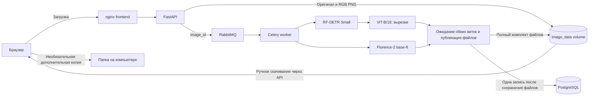

# План проекта: простая обработка изображений

Актуальное уточнение пользователя от 19.10.2026 заменяет прежнюю схему заданий,
статусов и публикации через БД. Научные сравнения, веса и исходные материалы не меняются.

## Поток

Пять контейнеров: frontend, backend, db, rabbitmq, worker. FastAPI сохраняет входные
файлы и синхронно публикует `image_id` с RabbitMQ publisher confirms; БД при загрузке
не используется. `202` подтверждает только принятие брокером. Если подтверждение
потеряно, входы остаются: сообщение уже могло быть доставлено.

Одна задача `process_image(image_id)` выполняет две параллельные ветки:
RF-DETR Small → ViT-B/16 на всех crops и независимый Florence-2 base-ft на целом
нормализованном изображении. Перед сохранением файлов задача ждёт обе ветки.
Это уточнение пользователя от 19.10.2026 отменяет прежний последовательный запуск
аннотатора в приложении. Concurrency 1, prefetch 1, batch 1: одновременно обрабатывается
одно изображение. Два потока координатора только обмениваются IPC; CUDA остаётся
в отдельных модельных процессах. Три постоянных subprocess загружаются
и прогреваются до consumer; CUDA не инициализируется в Celery prefork. Общий
`storage/locks/inference.lock` удерживается весь срок жизни моделей. Перед сравнением
остановить worker. Порог/параметры и хеши — в `backend/checkpoints.json`.
Перед изменением весов/параметров завершить очередь и пересоздать worker.
При обычной ошибке модели другая ветка завершается до следующего изображения;
успешный комплект не создаётся. Прерывание координатора, ошибка IPC, таймаут
резидентного процесса или OOM отменяют активные запросы и требуют рестарта worker,
чтобы незавершённый ответ не попал в следующее изображение.
Реальное ускорение и запас RAM/VRAM при параллельной нагрузке пока не проверены.

## Файлы и данные

Входы: `image_data/<image_id>/original`, `normalized.png`. JPEG/PNG до 10 MiB и
25 Мп; проверить декодирование, кадры, EXIF orientation, нормализовать в RGB PNG.

После успеха всех трёх этапов комплект **всегда** сохраняется в
`image_data/results/<image_id>/`: `original`, `normalized.png`, `detection.png`,
`results.json`. Временный каталог становится видимым через одно переименование;
файлы и каталог синхронизируются на диск. Входной каталог удаляется только после
commit БД. Основные файлы при скачивании не удаляются.

`detection.png` содержит исходные COCO bbox/labels. Классификатор получает crop
с отступом 10% по ширине/высоте с каждой стороны; bbox не меняется.
Детекция — `object_id`, `label`, `bbox` (xyxy в пикселях нормализованного PNG).
Классификация — тот же `object_id` и один `label`. Исходный `raw_caption` неизменен.
При отсутствии объектов классификация пустая; аннотатор всё равно выполняется.
Семантический словарь сохранён как исторический материал, но в новом API не используется.

Новая активная таблица `processed_images`: `id` (UUID PK), `original_path`,
`normalized_path`, `result_path`, `width`, `height`, `models`, `detection`,
`classification`, `annotation` (последние четыре поля — JSONB).
Одна строка — полностью обработанное изображение. Бинарные изображения находятся
в volume, в БД — пути и результаты. Нет записей заданий, статусов, ошибок, попыток,
промежуточных этапов, top-k, scores, хешей, повторных размеров и замеров.

Миграция `c81f0e392ab4` только добавляет таблицу. Прежние `images`, `jobs`,
`model_results` и миграции оставлены для сохранности истории, новый поток их не
использует. Удалять или переносить прежние результаты этой задачей не требуется.
Старую очередь с `job_id` завершить прежним worker перед обновлением кода.

## Доставка и ошибки

RabbitMQ — durable exchange/queue `inference`, persistent JSON-сообщения,
late ACK и reject-on-worker-lost. Celery result backend, Redis, Beat, Flower не нужны.
Worker сначала проверяет доступность таблицы `processed_images`.

После инференса: сохранить файлы → commit PostgreSQL → ACK. Повторная доставка
готового UUID пропускает модели. Если файлы сохранены, но commit не прошёл,
worker после восстановления БД берёт `results.json` и повторяет только запись БД.
Потеря модельного процесса/координатора требует рестарта worker и redelivery.
До публикации файлов незавершённое изображение может быть обработано повторно целиком.

Ошибки моделей/файлов — в логах worker; готовая запись БД не создаётся. Входы остаются,
частичные ответы не записываются. Отдельного восстановления этапов, счётчиков попыток,
callback и сообщений об ошибках инференса пользователю нет. Гарантии exactly-once нет.
HTTP-валидация и ошибки доставки/скачивания сохраняются на границах системы.

## Интерфейс и дополнительная копия

Frontend только загружает файл и по запросу скачивает готовые файлы. Polling и
endpoints `/jobs/...` удалены. Дополнительная папка выбирается **на компьютере
пользователя**, в поддерживаемом браузере через File System Access API на localhost
или HTTPS. Пользователь после обработки нажимает «Сохранить копию»; браузер записывает
четыре файла в подпапку UUID. До готовности файлы недоступны (`404`), можно повторить
сохранение позже. Автоматически писать в папку компьютера worker не может.
Без выбора папки или поддержки API можно скачать ZIP. Сохранение в volume обязательно
в обоих случаях; состояние папки компьютера не передаётся серверу.

| API | Назначение |
|---|---|
| `POST /images` | Загрузка и непосредственная публикация в очередь; `202`: `image_id`, `output_folder`. |
| `GET /images/{image_id}/files/{filename}` | Ручное скачивание одного из четырёх разрешённых файлов. |
| `GET /images/{image_id}/archive` | Ручное скачивание полного ZIP. |
| `GET /health` | Проверка RabbitMQ для приёма загрузки. |

Доступ только по UUID к разрешённым именам внутри image volume. Авторизация, поиск,
редактирование, обучение, fine-tuning и LoRA не входят в текущий этап.

## Реализация и проверка

Слои API/service/repository сохранены: API — HTTP, service — загрузка/скачивание,
repository — готовые результаты БД, processing — последовательность и сохранение.
Новых сервисов и универсальных диспетчеров не добавлять.
CPU/mock-тесты и интеграцию PostgreSQL/RabbitMQ/отдельного Celery worker отличать
от настоящего GPU smoke. Новые реальные запуски моделей и сравнений этой задачей
не разрешены. Команды запуска, обновления и проверки — в [README.md](README.md).
