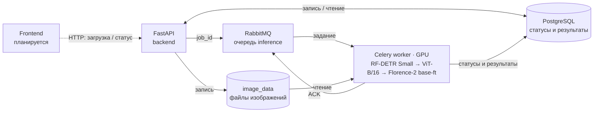

# Инфраструктура приложения

Схема для презентации: [PNG](project-infrastructure.png), [SVG](project-infrastructure.svg).
SVG редактируется и масштабируется без потери качества; PNG имеет размер 3200 × 1800.

Четыре контейнера приложения определены в `compose.app.yaml`; доступ worker к GPU —
в `compose.app.gpu.yaml`. Frontend показан как планируемый пятый контейнер:
его реализации и сервиса в Compose пока нет. Схема отражает архитектуру, а не
подтверждённую GPU-приёмку: реальный проход трёх моделей ещё требует smoke-проверки.

1. Пользователь загружает изображение через frontend в FastAPI.
2. API сохраняет исходное и нормализованное изображения в `image_data`, создаёт
   задание в PostgreSQL и публикует его `job_id` в RabbitMQ.
3. Celery worker получает задание из очереди `inference`, читает изображение из
   общего volume и последовательно запускает RF-DETR Small, ViT-B/16 и Florence-2
   base-ft. Классификатор обрабатывает вырезки найденных объектов. Каждый этап
   выполняется в отдельном дочернем процессе внутри одного контейнера worker;
   предыдущий модельный процесс завершается до запуска следующего.
4. Worker записывает статусы и результаты этапов в PostgreSQL и подтверждает
   обработку сообщения брокеру. Веса подключены только к worker, read-only;
   доступ к GPU есть только у worker. Общий `inference.lock` исключает
   одновременный инференс приложения и сравнительных запусков.
5. Frontend запрашивает статус и JSON-результаты у API. API читает их из БД.
   UI и выдача изображений/overlay относятся к дальнейшей реализации.

На рисунке для краткости не показаны постоянные volumes `pgdata` и
`rabbitmq_data`, а также файл блокировки. `image_data` доступен API для записи,
worker — только для чтения. Вырезки объектов временные; координаты и связь
классификаций с объектами сохраняются в БД.

Редактируемый вариант Mermaid:

