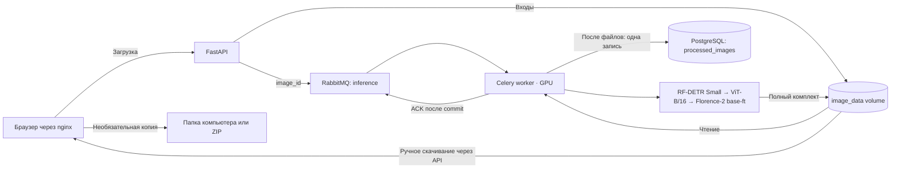

# Инфраструктура приложения

Текущая схема от 19.10.2026. Пять сервисов уже определены в compose.app.yaml.
[Сохранённые PNG](project-infrastructure.png) и [SVG](project-infrastructure.svg)
относятся к прежней архитектуре с заданиями/статусами и сохранены как история.
Актуальная схема — ниже; подробности в [плане](../../PROJECT_PLAN.md).

API не обращается к БД и не создаёт заданий. Worker хранит три модели в постоянных
процессах, вычисляет последовательно и сохраняет итоговый комплект в volume всегда.
После сохранения файлов — одна строка processed_images. Ошибки — только в логах.
В интерфейсе нет опроса статусов; дополнительная копия запрашивается вручную.
У nginx нет image volume/секретов/весов. Веса worker read-only, image volume writable.
Общий inference.lock занят весь срок жизни моделей. GPU smoke и mock-интеграция
отличаются: эта переделка проверяется без запуска настоящих моделей.
